# ServDock

English | [中文](README.md)

[](https://github.com/hlskysong/ServDock/releases)
[](LICENSE)
[](#install)

A local service and runtime console for macOS. It puts **Homebrew services, launchd / cron jobs, Docker / OrbStack containers, Bun / fnm / mise version managers and Homebrew packages** into one window — and ships a **JSON CLI built for scripts and AI agents**.

The interaction model is inspired by [FlyEnv](https://github.com/FlyEnvApp/FlyEnv), but the app is **SwiftUI compiled directly with `swiftc`** — no Xcode project, no SPM third-party dependencies.

## Install

Grab `ServDock-<version>.zip` from [Releases](https://github.com/hlskysong/ServDock/releases), unzip it and drag `ServDock.app` into `/Applications`.

Builds are ad-hoc signed by default, so the first launch is stopped by Gatekeeper once: right-click → Open → Open. Or clear the quarantine flag:

```bash
xattr -dr com.apple.quarantine /Applications/ServDock.app
```

You can verify the download against the `.sha256` shipped with the release: `shasum -a 256 -c ServDock-0.3.0.zip.sha256`.

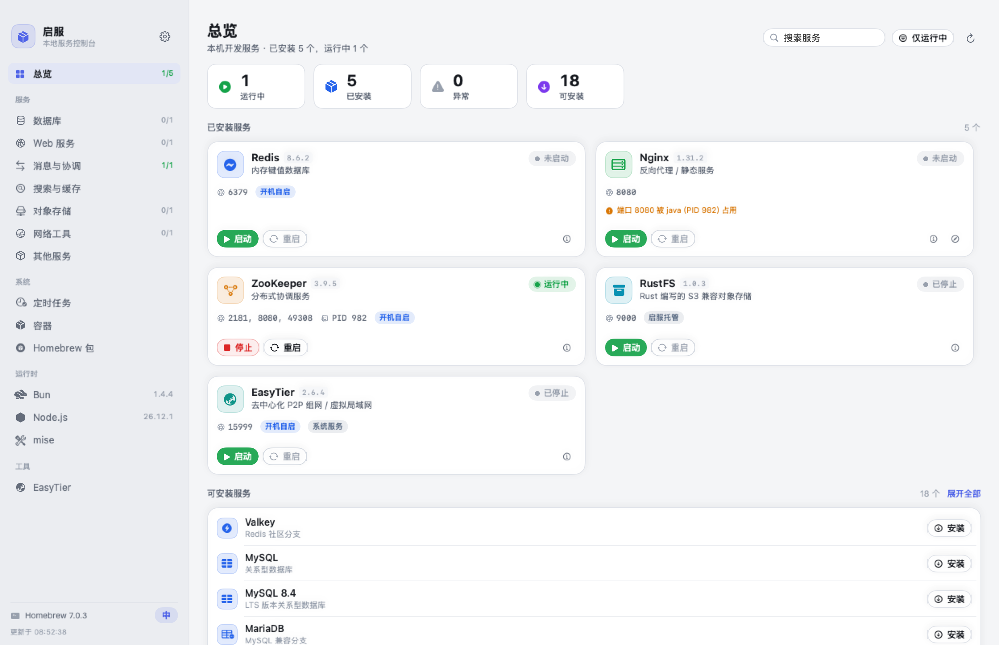

## Progress

| Stage | Scope | Status |
| --- | --- | --- |
| 1 | Homebrew services (Redis / Nginx / ZooKeeper / MySQL / PG …) | ✅ Done |
| 2 | Bun runtime (version, cache, global tools, install & upgrade) | ✅ Done |
| 3 | fnm / Node (version list, default switch, install, uninstall, disk usage) | ✅ Done |
| 4 | MongoDB (8.0 / 7.0 lines) and RustFS (no brew service — hosted by a local LaunchAgent) | ✅ Done |
| 5 | Timers / scheduled tasks (LaunchAgents, LaunchDaemons, cron) | ✅ Done |
| 6 | EasyTier networking (daemon control + peer / route tables + local network info) | ✅ Done |
| 7 | Homebrew packages (search / install / list / uninstall, formulas and casks) | ✅ Done |
| 8 | mise dev environments (tool list, registry search, install / upgrade / uninstall versions) | ✅ Done |
| 9 | Chinese / English UI (switchable, persisted, CLI `--lang`) | ✅ Done |
| 10 | Resource footprint (brew cache + adaptive polling) | ✅ Done |
| 11 | Docker / OrbStack container management (containers, images, engine state) | ✅ Done |
| 12 | JSON CLI for scripts and AI (subcommands + unified envelope + exit codes) | ✅ Done |
| 13 | Version check and self-update (GitHub Release + universal binary + one-click replace & relaunch) | ✅ Done |

## Build & Run

```bash
bash build.sh          # compile and package build/ServDock.app (ad-hoc signed)
open build/ServDock.app
bash run.sh            # compile and restart
```

Requirements: macOS 14+, Command Line Tools (`xcode-select --install`). A full Xcode install is not needed.

`build.sh` honours these environment variables: `SERVDOCK_ARCHS="arm64 x86_64"` (multiple architectures are merged into a
universal binary with `lipo`), `SERVDOCK_VERSION` / `SERVDOCK_BUILD` (override the version in Info.plist — CI injects them from the tag),
`SERVDOCK_SIGN_IDENTITY` (real signing identity; omitted means ad-hoc) and `SERVDOCK_MIN_MACOS` (defaults to 14.0).

## Release & Updates

**Releasing**: tag and push — GitHub Actions does the rest.

```bash
git tag v0.3.0
git push origin v0.3.0      # triggers .github/workflows/release.yml
```

The pipeline: compile arm64 + x86_64 on `macos-14` → `lipo` into a universal binary → assert bundle version and architectures →
`ditto -c -k --keepParent` into `ServDock-<version>.zip` plus `.sha256` → create the GitHub Release (auto-generated notes; a version
containing `-` is marked as a prerelease). You can also run it manually via `workflow_dispatch` with an explicit version. `ci.yml`
covers compile checks on every push / PR so broken commits don't surface only after release.

**Update check**: at launch the app queries `api.github.com/repos/hlskysong/ServDock/releases/latest` at most once every **24 hours**
(not part of the service polling loop, so `--bench` subprocess counts are unaffected) and compares `tag_name` against
`CFBundleShortVersionString` segment by segment. An amber version badge appears in the sidebar footer, the Settings page reports an
available update, and "Skip This Version" is remembered in `UserDefaults` (still re-checked 24h later, and can be undone).

**One-click update**: download the `.zip` → `ditto` extract → verify the version inside the archive matches the release → write a
replace script that waits for the old process to exit (`rm -rf` old bundle → `ditto` new bundle → strip quarantine → `open`), then quit
so the script can take over. A development build (`build/ServDock.app`) **never** replaces itself — the button degrades to
"Open Releases" so the build directory is never destroyed.

Pure CLI check:

```bash
$BIN update --json          # {current, latest, state, update_available, asset, can_self_install, skipped, page_url}
```

**Signing & notarization (optional)**: builds are ad-hoc signed by default — fine for personal use, but other people get one
Gatekeeper prompt. For proper distribution, add these repository secrets (`Settings → Secrets and variables → Actions`) and the
pipeline switches to Developer ID signing + notarization automatically. Each step is skipped when its secret is missing, so a
partially configured repo still releases fine:

| Secret | Value |
| --- | --- |
| `MACOS_CERT_P12` | the exported Developer ID Application `.p12`, base64-encoded on one line (`base64 -i cert.p12 \| pbcopy`) |
| `MACOS_CERT_PASSWORD` | password chosen when exporting the p12 |
| `APPLE_ID` | Apple ID used for notarization |
| `APPLE_TEAM_ID` | Team ID (the value in parentheses of the certificate name) |
| `APPLE_APP_PASSWORD` | app-specific password from appleid.apple.com |

With a certificate but no Apple account you get signing without notarization. Once notarization passes, the bundle is
`stapler staple`d, re-zipped and the `.sha256` is recomputed.


## Features

**Services (stages 1 / 4 / 6)**

- Card-based overview: run state, version, port, PID, launch-at-login, hosting-mode badge
- Start / stop / restart / this-session-only start (`brew services run`)
- Port conflict detection: when the default port is held by another process it is flagged in red (e.g. Nginx's 8080 occupied by ZooKeeper's `java`)
- Category browsing: Databases / Web / Messaging & Coordination / Search & Cache / **Object Storage** / Network Tools / Other (MinIO and RustFS live under Object Storage)
- Three-pane detail: Overview (identity, hosting mode, version, PID, plist, data directory), Logs (tail with 2s auto-refresh), Config (read-only preview)
- One-click install for 23 common services; an "untrusted tap" refusal from Homebrew 7 is handled automatically with `brew trust` and a retry

**Three hosting modes (core design)**

| Mode | Applies to | Lifecycle implementation |
| --- | --- | --- |
| `brew` | Redis / Nginx / MongoDB… (formula ships a `service do` block) | `brew services start/stop/restart` |
| `managed` | **RustFS** (brew only installs the binary, no service definition) | Generate `~/Library/LaunchAgents/local.servdock.<id>.plist` + `launchctl bootstrap/bootout` |
| `external` | **EasyTier** (the official GUI ships its own system-level LaunchDaemon) | `launchctl bootstrap/bootout system`, behind the admin authorization prompt |

**Scheduled tasks (stage 5)**

- Every launchd job in one page: user agents (`~/Library/LaunchAgents`), system agents (`/Library/LaunchAgents`), system daemons (`/Library/LaunchDaemons`)
- Rules translated into plain language: `daily at 10:15`, `every Monday 08:30`, `every 1 hour`, `always running (KeepAlive)`, `at login` — calendar rules also show the **next fire time**
- Real runtime state: PID, last exit code, loaded / not loaded; **the system domain is readable too** (`launchctl print system/<label>` needs no privileges)
- Actions: load / unload, run once now (`kickstart`), enable / disable (`enable` / `disable`, disabled means not loaded at boot), view logs (`StandardOutPath`), reveal the plist in Finder
- cron: parses `crontab -l` and shows expression + plain-language rule + command, with one-click `crontab -e` in Terminal
- Starting or stopping system-level jobs needs admin rights; `osascript ... with administrator privileges` raises the system password prompt, and cancelling reports "admin authorization cancelled"

**Runtimes (stages 2 / 3)**

- Bun: version, global bin directory, cache size, global packages, PATH detection, one-click upgrade
- Node: fnm version list + npm version + disk usage, set default (`fnm default`), install any version (`lts` / `22` / `v20.11.0`), uninstall
- Menu bar item: start and stop services without opening the main window

**EasyTier networking (stage 6)**

- Data comes from `easytier-cli -p <rpc> -o json peer|node`; the RPC port is read from `--rpc-portal` in the system plist (the GUI daemon usually uses 15999, the CLI default is 15888)
- 10-column aligned peer table: virtual IPv4 / hostname / route (p2p, relay, Local) / protocol / latency / upload / download / loss / NAT type / version — zebra striping, right-click to copy IP or hostname
- Local info: virtual IP, hostname, NAT type, network name, public IP, peer count, RPC port, plus listeners and the config directory
- Liveness check: process table hit **or** RPC reachable (the GUI daemon is not listed by `launchctl list`, so process-table-only detection reports "not running" incorrectly)
- When `easytier-cli` is missing the page offers "Download CLI": fetches the GitHub release zip into `~/Library/Application Support/ServDock/bin` without touching system paths

**Homebrew packages (stage 7)**

- Search and Installed tabs, switchable between formulas and casks
- Installed list comes from `brew list --formula` / `--cask`; search results are enriched with `brew search` + `brew info --json=v2` for version, summary and homepage
- Install / uninstall shells out to brew and automatically recovers from Homebrew 7's "untrusted tap" with `brew trust` + retry; rows can jump to Terminal for `brew info`

**mise (stage 8)**

- Overview: version, number of managed tools, shell activation state, login shell (with a copy-paste onboarding card when not activated)
- Tool table: name, version, downloaded / active state, plus upgrade and uninstall
- Install: registry search, quick chips for common tools, version picker (`mise ls-remote` list + manual entry)
- Actions: `mise use -g`, `mise uninstall`, `mise upgrade`, `mise self-update`, write shell activation config

**How mise activation is determined (important)**

`activated:` in `mise doctor` only reflects the **current process** environment. A GUI app is not launched from a login shell, so it is always `no` — using it as the criterion reports "not activated" forever. The real criterion is whether the **shell startup file contains `mise activate`**:

| shell | Files checked |
| --- | --- |
| fish | `~/.config/fish/config.fish` + `~/.config/fish/conf.d/*.fish` |
| zsh | `~/.zshrc`, `~/.zprofile`, `~/.zshenv` |
| bash | `~/.bashrc`, `~/.bash_profile`, `~/.profile` |

The login shell is resolved via `getpwuid` (a GUI process's `$SHELL` is often the system default).

Note that `mise activate` **only prints a script to stdout** — running it bare is just "looking at it". It must be handed to the shell:

```bash
mise activate fish | source          # fish
eval "$(mise activate zsh)"          # zsh
eval "$(mise activate bash)"         # bash
```

The in-app "Write fish config" button appends that line to the matching file (idempotent, skipped when already present); `ServDock --mise-activate fish` goes through the same code path.

Newer mise versions inject PATH directly via activate and **no longer rely on `~/.local/share/mise/shims`**, so a missing directory is normal and is not evidence of "not activated".

**Docker / OrbStack (stage 11)**

- Engine card: docker CLI path, engine type (OrbStack / Docker Desktop / Colima / Rancher auto-detected), server version, container and image counts, image size and reclaimable space
- **When the engine is down you get a button you can click**: OrbStack detected → "Start OrbStack" (`orb start`), otherwise it points at Docker Desktop / colima; the raw `docker` error is folded into 3 lines so you can tell a missing socket from a permission problem
- Container table: name / image / status / ports / uptime, with a colored dot for state; `0.0.0.0:6379->6379/tcp` is normalized to `6379→6379`
- Actions: start / stop / restart / remove / logs (`docker logs --tail 200`, copy all), right-click to copy name, ID or ports
- Images tab: `repo:tag`, size, created, short ID, with `docker system df` image usage on top
- Stopped containers show `Exited (0)` instead of the ellipsis-truncated `Exited (0) 2 minutes...`

**AI-friendly CLI (stage 12)**

A subcommand set for scripts and agents, with four hard rules:

1. **Every query supports `--json`** with a unified envelope: `{ok, schema, tool, version, command, data}`; failures return `{ok: false, error: {code, message}}`
2. **Stable field names**: lowercase snake_case, states as enum literals (`started` / `stopped` / `running` / `exited`) — never localized text
3. **Exit codes**: `0` success / `1` action failed / `2` usage error
4. **`help --json` emits a machine-readable command list** so tools can self-discover instead of guessing

Action commands (service lifecycle, container operations, timers) **read the real state back** after acting and report that, instead of just saying "sent".

**Localization (stage 9)**

- Three switches: sidebar footer badge, language card in Settings, `⌘⇧L` to toggle English; persisted in `UserDefaults` (`servdock.language`)
- The **Chinese source string is the key**; missing English entries fall back to Chinese; `%@` / `%d` placeholders go through `String(format:)`
- Shared components (PillButton / IconButton / KeyValueRow / TagChip / EmptyStateView / SearchField / InfoTile …) translate internally, so call sites only write Chinese

**Resource footprint (stage 10)**

- **brew result caching**: `brew --version` and `brew list --versions` are cached for 60s and invalidated on install / uninstall / upgrade → subprocesses per cycle drop from 6 to 4
- **Adaptive polling**: 4s while the app is frontmost and the main window is visible; 30s when the window is closed / minimized / the app loses focus, restoring immediately on return (driven by `didBecomeActive` and window visibility notifications rather than reading state on a timer)
- **On-demand probing**: timers, EasyTier, mise and the package list only run when their page is opened or a manual refresh happens — never in the polling loop
- Measured with `--bench`: subprocesses per collection cycle **6 → 4**, wall clock **940 ms → 532 ms**; `brew list --versions` alone went from 332 ms to 0 ms

**Version updates (stage 13)**

- **Zero polling**: one GitHub Release check per 24 hours after launch; "Check for Updates" in Settings runs it on demand
- Three touch points: amber version badge in the sidebar footer (opens Settings), the "Updates" card in Settings (current / latest / published / last checked / release notes), and `update --json`
- **Skip This Version**: stored in `UserDefaults`; the 24h check still reminds you about other versions, and skipping can be undone
- **One-click replace**: download zip → unpack → verify inner version → wait for self to exit → replace bundle → strip quarantine → relaunch
- Self-replace is gated: only outside `build/` and only when the containing directory is writable, otherwise the button becomes "Open Releases"
- Version comparison is numeric per segment (`0.10.0 > 0.9.1`), not string ordering

## Screenshots

| Timers | cron |
| --- | --- |
| 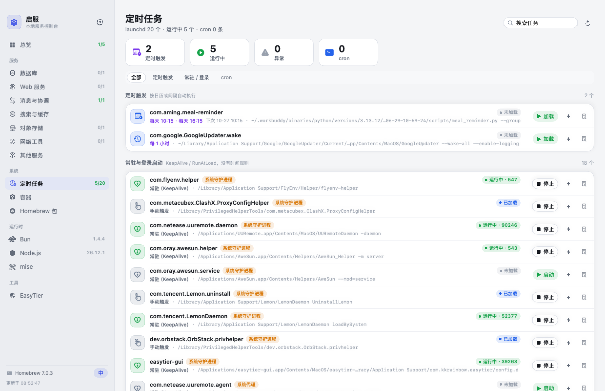 | 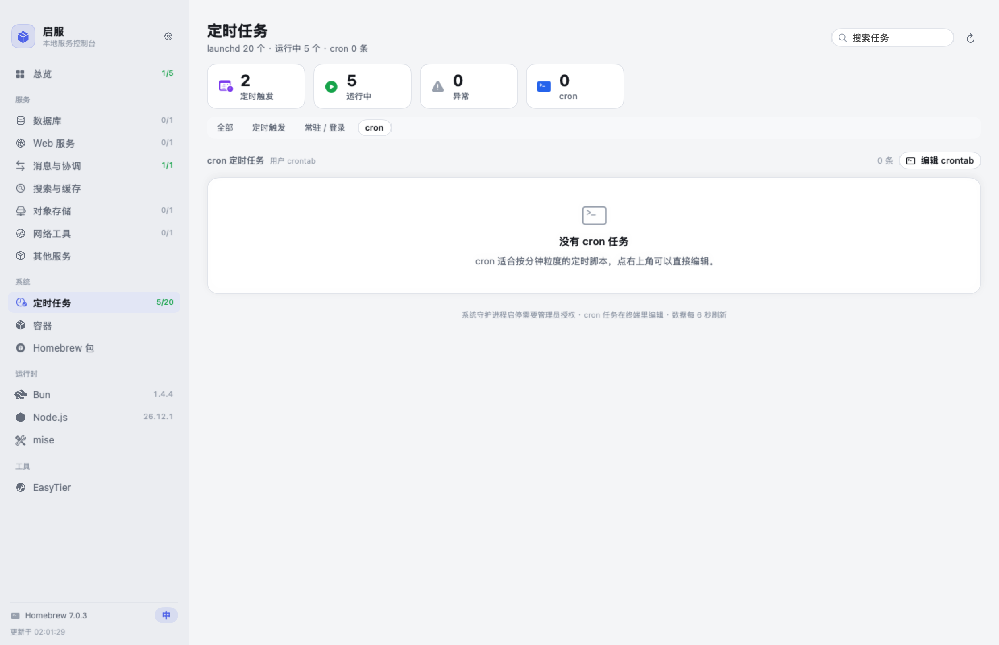 |

| Service detail · overview | Service detail · logs |
| --- | --- |
| 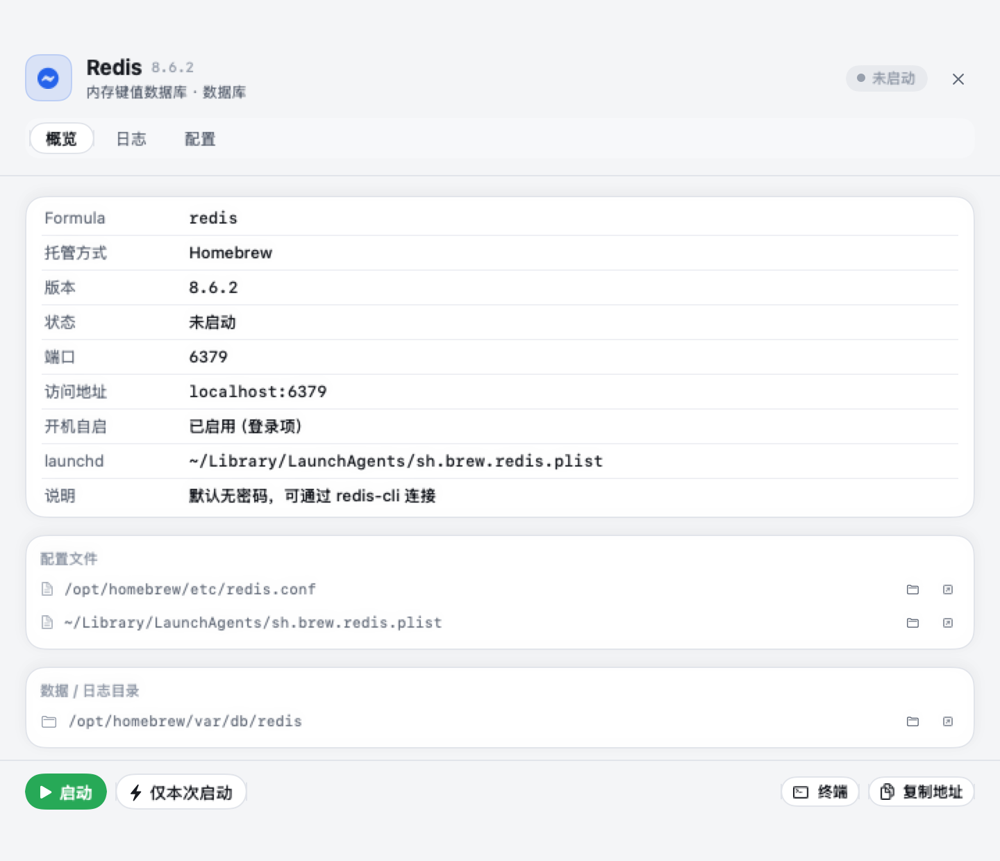 | 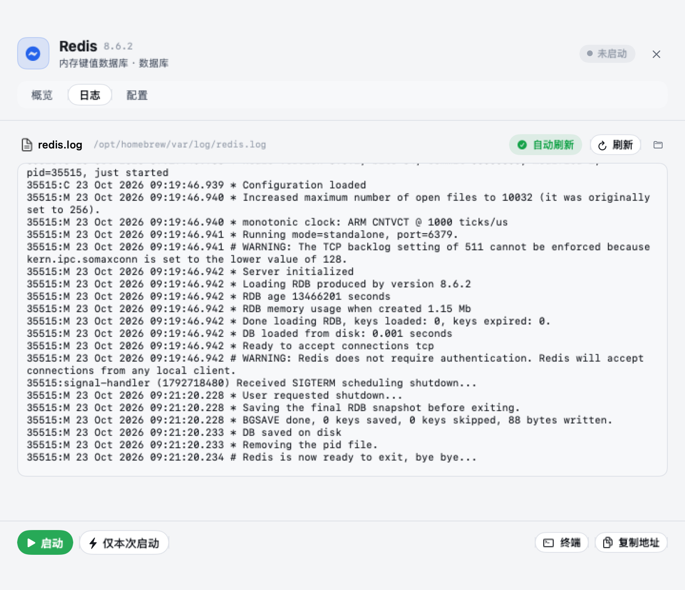 |

| Bun | Node.js (fnm) |
| --- | --- |
| 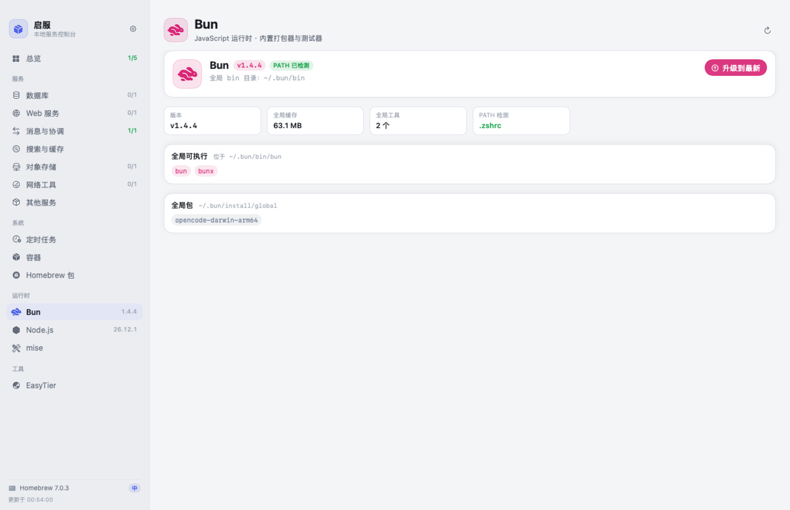 | 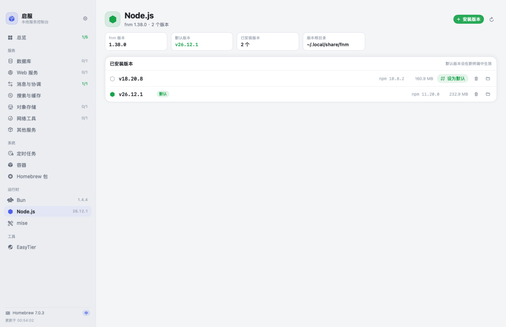 |

| EasyTier | Homebrew packages |
| --- | --- |
| 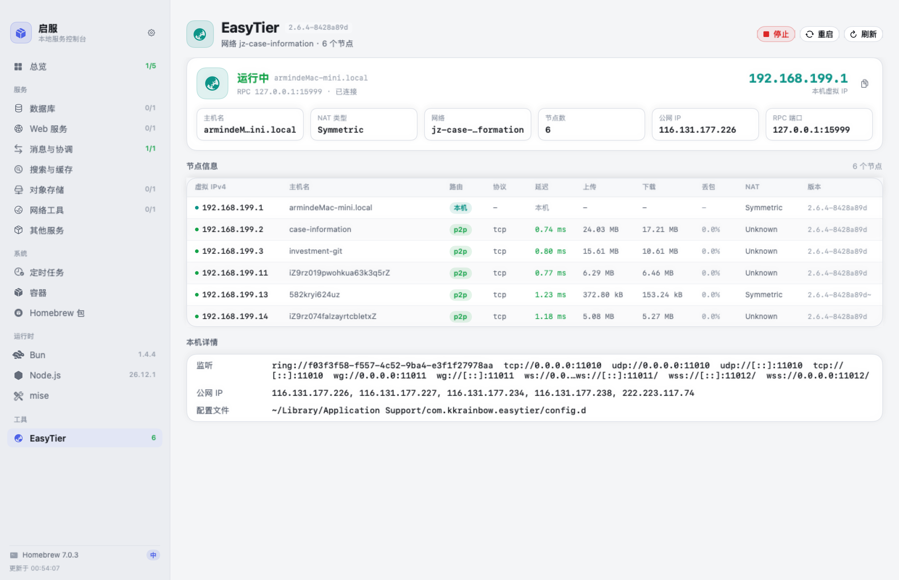 | 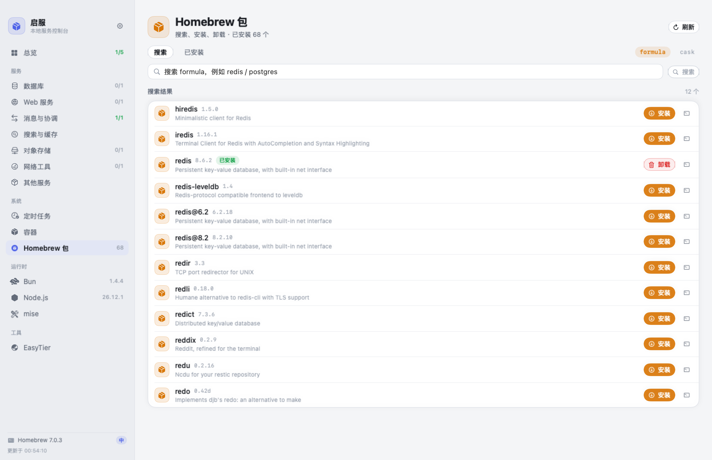 |

| mise | Object storage |
| --- | --- |
| 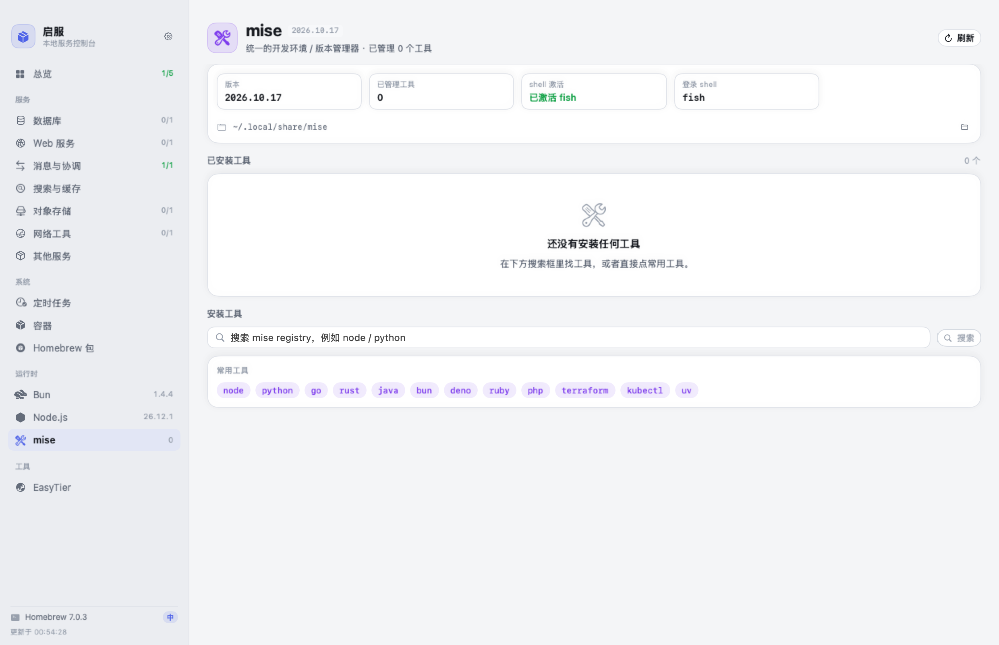 | 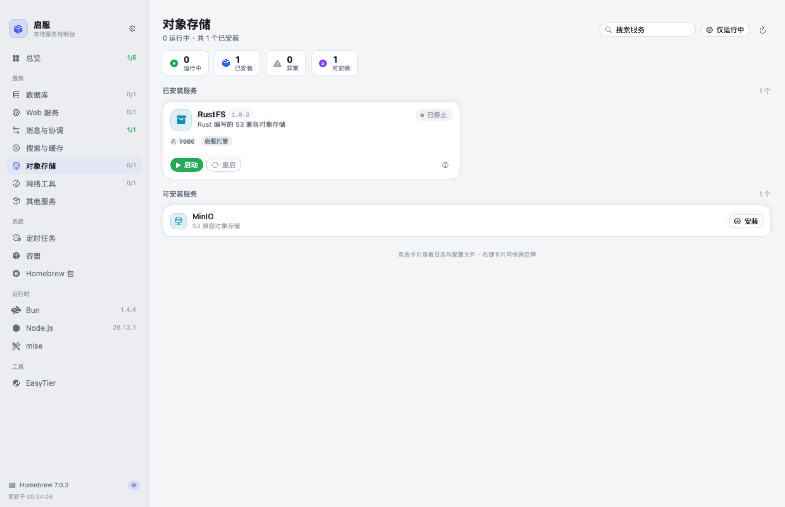 |

| Docker containers | Docker images |
| --- | --- |
| 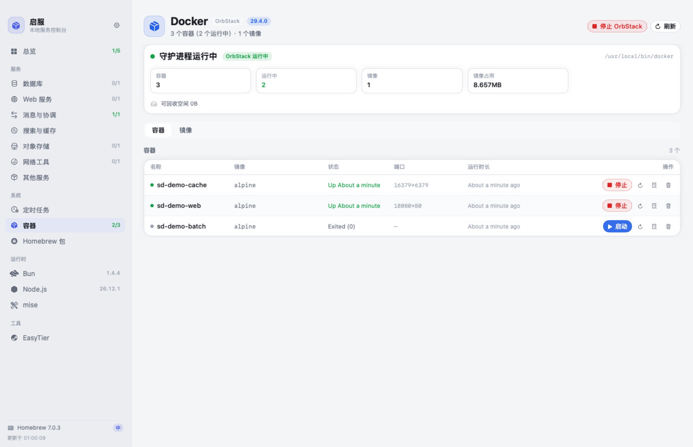 | 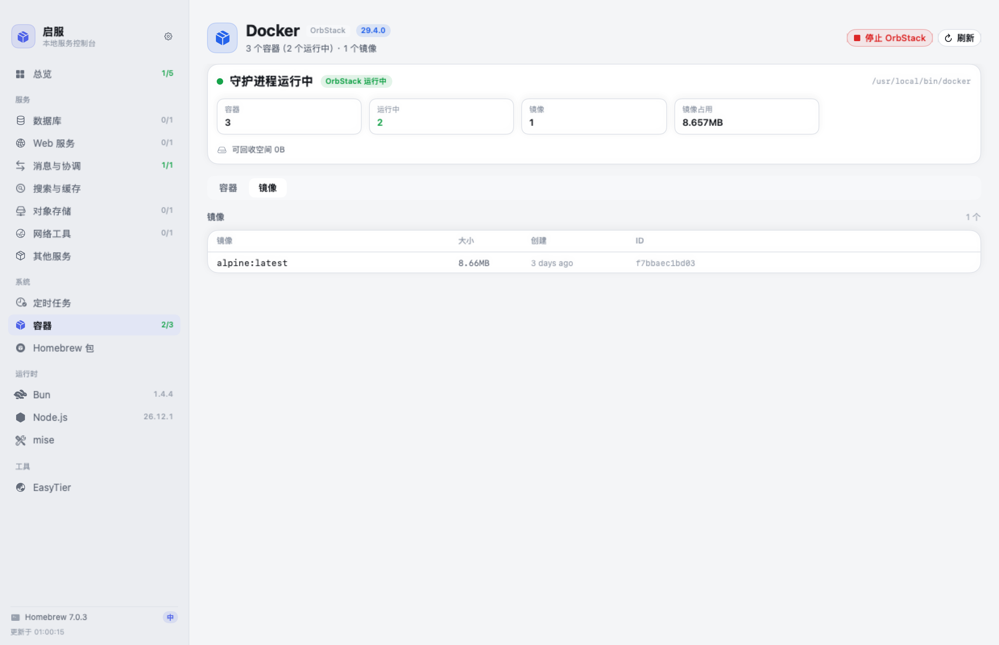 |

| Settings · language | English UI |
| --- | --- |
| 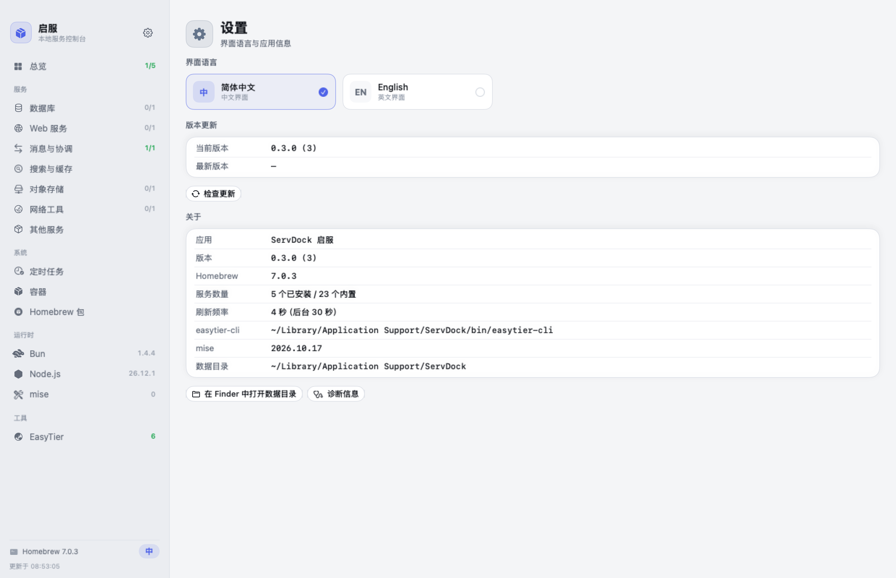 | 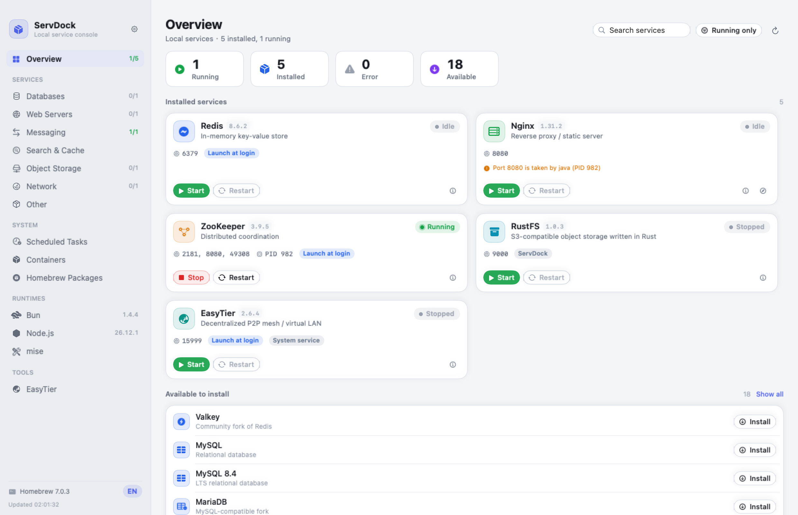 |

Dark mode:

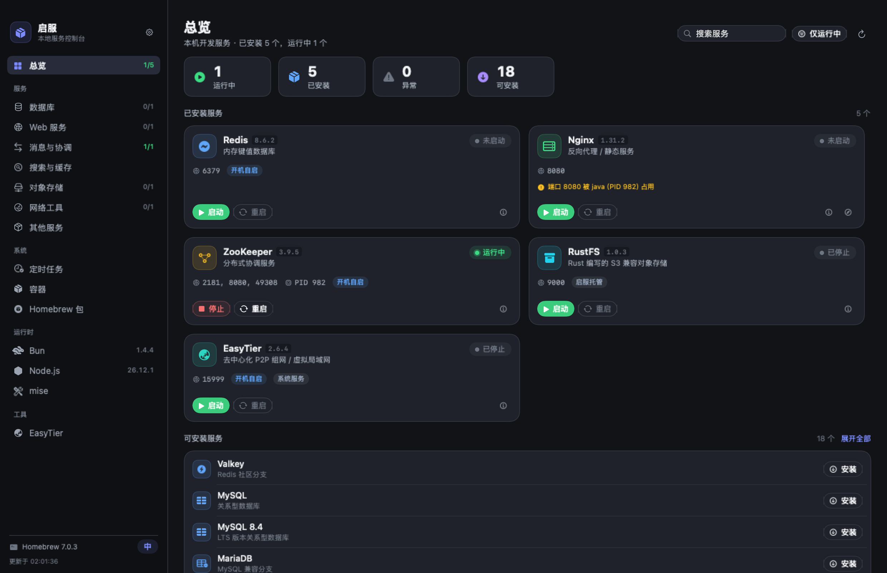

## Code structure

```
Sources/
  App.swift                  # entry point, window, menu bar, offscreen snapshots
  Models/
    ServiceSpec.swift        # service catalog (23) + categories + three hosting modes + path helpers
    ServiceItem.swift        # static description merged with live state
    TimerItem.swift          # launchd jobs / cron entries / rule translation + next fire time
  Core/
    Shell.swift              # Process runner (own PATH, timeouts, output captured via temp files)
    SystemProbe.swift        # brew services --json / brew list --versions / launchctl / lsof / ps
    BrewCache.swift          # 60s cache for brew --version and brew list --versions (invalidated on change)
    Launchctl.swift          # launchctl wrapper: user domain, elevated system domain, LaunchAgent generation
    TimerProbe.swift         # scans plists + crontab + launchctl print for system-domain state
    RuntimeProbe.swift       # Bun and fnm probing
    EasyTierProbe.swift      # easytier-cli peer / node JSON parsing, RPC port detection, CLI self-download
    BrewCatalog.swift        # brew search / info --json=v2 / installed enumeration / install & uninstall (with tap-trust retry)
    MiseProbe.swift          # mise doctor / ls --json / registry search / install, upgrade, uninstall / shell activation
    DockerProbe.swift        # docker CLI lookup, engine probing, container / image / df parsing, container and OrbStack actions
    UpdateProbe.swift        # GitHub Release version check, semver compare, download / unpack / self-replace
    LogLocator.swift         # log discovery, tail and config reading
    AppModel.swift           # state machine: adaptive polling (4s foreground / 30s background), 90s runtime cache
    AppModel+Actions.swift   # start/stop (routed by hosting mode), install, Bun upgrade, Node version actions
    AppModel+Timers.swift    # timer loading and actions
    AppModel+Tools.swift     # EasyTier / Homebrew packages / mise / Docker / language switching
    CLIRunner.swift          # CLI subcommands (list/status/start/logs/containers/timer/runtime/doctor + --json)
    ProbeRunner.swift        # CLI: --probe
    BenchRunner.swift        # CLI: --bench (collection timing / polling-interval self-check)
    ActionRunner.swift       # CLI: --action
  Support/
    Brand.swift              # brand name / bundle id / data dir / legacy bundle name (ServiceDock) migration
    L10n.swift               # language enum + L.t lookup (Chinese as key)
    L10nDictionary.swift     # 480+ Chinese–English entries
    Summarize.swift          # output first line / error summarization
  Views/                     # sidebar, overview, cards, detail, timers, Docker, EasyTier, packages, mise, settings, runtime pages, components
Tools/make-icon.swift        # generates AppIcon.icns
.github/workflows/
  ci.yml                     # compile check + CLI smoke test on push / PR
  release.yml                # tag v* → universal binary → zip + sha256 → GitHub Release
```

## Command line

### Subcommands (for scripts / AI)

```bash
BIN=build/ServDock.app/Contents/MacOS/ServDock

$BIN list                                  # service list (table)
$BIN list --json                           # machine readable
$BIN list --installed --running            # only installed and running
$BIN status redis --json                   # every field for one service
$BIN start redis / stop redis / restart redis
$BIN run redis                             # this session only, no launch-at-login
$BIN logs redis --lines 50

$BIN containers                            # container list (includes stopped by default)
$BIN containers --running --json
$BIN container stop my-redis --json        # start|stop|restart|rm|logs
$BIN container logs my-redis --lines 100
$BIN images
$BIN docker-status --json                  # engine / OrbStack state

$BIN timers --json
$BIN timer run com.example.job             # run|load|unload|enable|disable
$BIN runtime --json                        # bun / node / mise overview
$BIN doctor --json                         # environment health check
$BIN update --json                         # check the GitHub release (read-only, no install)
$BIN help --json                           # command list (for AI self-discovery)
```

JSON output looks like this:

```json
{
  "ok": true,
  "schema": 1,
  "tool": "ServDock",
  "version": "0.2.0",
  "command": "container",
  "data": {
    "name": "my-redis",
    "verb": "stop",
    "previous_state": "running",
    "state": "exited",
    "running": false
  }
}
```

On failure: `{"ok": false, "error": {"code": "not_found", "message": "Unknown service: foo"}}` with exit code `1`.

`code` values: `bad_usage` / `not_found` / `not_installed` / `action_failed` / `engine_down` / `cli_missing` / `no_log`.

### Development and self-check flags

```bash
$BIN --probe                                      # print all probe results (brew / ports / PID / timers / bun / node)
$BIN --bench                                      # self-check: subprocesses per cycle, wall clock (cold vs warm cache), polling rules, wake-up path
$BIN --snapshot out.png [--select bun] [--dark]   # offscreen render of the UI, for QA and docs
$BIN --snapshot out.png --lang en                 # English UI screenshot
$BIN --snapshot out.png --select easytier --redact # redacted screenshot: hostname / network name / public IP / virtual IP replaced
$BIN --action start rustfs [--out result.txt]     # run an action through the same code path as the UI
$BIN --mise-activate [fish|zsh|bash]              # write mise activate into the shell config (idempotent, defaults to the login shell)
```

`--select` accepts: `overview` (default) / `detail` / `logs` / `config` / `category` / `storage` / `timers` / `cron` / `bun` / `node` / `easytier` / `packages` / `packages-installed` / `mise` / `docker` / `docker-images` / `settings`.

## Pitfalls (already handled)

1. **brew exit codes are unreliable**: `brew list --versions` prints `Error:` and **exits 1** when an untrusted tap (e.g. `roversx/tap`) exists, yet all 67 stdout lines are valid. Every parser was changed to "parse whenever there is output" instead of gating on `ok`.
2. **Homebrew 7 changed launchd labels**: from `homebrew.mxcl.<formula>` to `sh.brew.<formula>`, and the plist from `~/Library/LaunchAgents/homebrew.mxcl.*.plist` to `sh.brew.*.plist`. Both prefixes are supported (both really exist on this machine).
3. **lsof needs explicit fields**: `lsof -Fpc` does not return ports — you need `-Fpcn`, and the port lives in the `n` field.
4. **GUI apps have no login-shell PATH**: `Process` must build its own `PATH` (including `/opt/homebrew/bin` and `~/.bun/bin`) before launching brew / launchctl.
5. **JVM services have no distinctive process name**: ZooKeeper / Kafka / ES all show up as `java`, so PID attribution needs "default port + java" as a hint.
6. **`pgrep -f` returned unrelated PIDs on this machine** (sandbox interference) and was removed from the main path; PID resolution is now four-stage: `launchctl` → `lsof` command name → port owner → `ps` table.
7. **RustFS's formula has no `service do` block**: `brew services` does not recognize it at all (upstream only installs the binary), so a LaunchAgent must be written — that is exactly what the `managed` layer exists for.
8. **`rustfs server --console-enable` is a boolean flag and must not take `true`**: an extra `true` is parsed by clap as the VOLUMES positional and the service fails to start.
9. **Homebrew 7 tap trust**: `brew install rustfs/homebrew-tap/rustfs` first refuses to load (`Refusing to load formula … from untrusted tap`) and needs `brew trust <tap>`; the install flow detects the error, trusts the tap and retries.
10. **System-domain state is actually readable**: `launchctl print system/<label>` gives `state = running` / `pid` / `last exit code` to a normal user without sudo; `launchctl print-disabled system` is readable too and drives the "disabled" badge.
11. **`launchctl list` only covers the current user domain**: system daemons (e.g. `easytier-gui`) never appear there — use `launchctl print system/*` or fall back to `ps`.
12. **The Bash tool sandbox blocks `launchctl` / `ps` / `crontab`**, and `open --args` arguments get swallowed. Verifying the real path requires launching a temporary `.app` through LaunchServices and letting it call the target; the app itself behaves normally in a real session.
13. **`easytier-cli` global flags must precede the subcommand**: `easytier-cli -p 15999 -o json peer` works, while `peer -o json` fails with `unexpected argument '-o'` and returns no JSON.
14. **EasyTier liveness cannot rely on the process table alone**: the GUI daemon is a system-domain LaunchDaemon, absent from `launchctl list`, and `ps` may be unreadable in restricted environments — that reports "not running" while the peer table clearly has data. The condition is now "process table hit **or** RPC reachable".
15. **A duplicate key in the localization dictionary crashes the app at launch**: Swift deduplicates dictionary literals at first initialization and traps with `EXC_BREAKPOINT / SIGTRAP` (stack points at `one-time initialization function for en`) — one duplicate out of 426 entries is enough. Duplicates must be checked after editing entries.
16. **`.disabled(true)` stacks an extra automatic dimming**: custom disabled styling (white fill + stroke + gray text) became nearly invisible under that layer; `.allowsHitTesting(false)` gives real control over rendering.
17. **`--snapshot` writing into the repo directory is blocked by the sandbox** (`sandbox-center … missing actual resource subject`): render to `/tmp` first, then copy into `docs/screenshots/`.
18. **Iterating `NSApp.windows` inside `MenuBarExtra` cannot reopen a closed window**: SwiftUI `WindowGroup` windows are destroyed on close, so the loop is always empty (the symptom is "menu bar → open main window does nothing" while the Dock icon works). The fix is `openWindow(id: "main")` to recreate it, then `activate` + `makeKeyAndOrderFront` on the next runloop.
19. **`static let` on an `@MainActor` type cannot be referenced from `nonisolated` context** (Swift 6 rejects it): polling interval constants must be `nonisolated static let` so pure functions can be called from non-isolated code such as `--bench`.
20. **`brew list --versions` alone costs 300+ ms**: it forks a ruby each time, and every 4 seconds all day adds up to tens of thousands of process spawns. Content that rarely changes must be cached (see `BrewCache`) and invalidated on install / uninstall, otherwise versions lag behind.
21. **`NSApp` is nil in a process that never started the app**: CLI branches such as `--bench` reading `NSApp.isActive` trap with `SIGTRAP` on the implicitly unwrapped optional (stack points at `AppModel.waitForNextTick()`, easily misread as a concurrency bug). Use `NSApplication.shared` everywhere.
22. **`mise doctor`'s `activated:` cannot answer "is it activated for the user"**: it only reads the current process environment. A GUI app never starts from a login shell so it is always `no`, and `shims_on_path: no` is normal on new mise versions (activate injects PATH directly). The criterion has to be grepping `mise activate` in shell startup files.
23. **`mise activate` prints instead of executing**: running it bare dumps a screen of `set -gx` / `function ...` and looks like an error. fish needs `mise activate fish | source`; zsh / bash need `eval "$(mise activate ...)"`.
24. **Renaming breaks already-running managed services**: LaunchAgents registered as `local.servicedock.*` in the system would "disappear" if the prefix were changed to `local.servdock.*` outright. The prefix is therefore chosen from **whatever plists actually exist on disk**, supporting old and new without forced migration; the data directory and `UserDefaults` keys do a one-time merge at launch (never overwriting newer data).
25. **`docker ps --format '{{json .}}'` returns a long `Ports` string**: `0.0.0.0:6379->6379/tcp, [::]:6379->6379/tcp` blows up the table and duplicates entries (one per v4 / v6). Split on `->` into host/guest ports and deduplicate.
26. **A stopped container's `Status` is `Exited (0) 2 minutes ago`**: with a narrow column the ellipsis eats the important part. The status column keeps only `Exited (0)`; running containers keep `Up 2 minutes`.
27. **`docker` hangs for seconds before failing when the engine is down**: probe timeouts must be short (12s) or the UI feels frozen; folding the socket-path error into 3 lines makes "not started" versus "wrong permissions" obvious.
28. **`Never`-returning CLI helpers collapse branches early**: declaring `emit()` / `fail()` as `-> Never` (calling `exit()` internally) lets `guard ... else { fail(...) }` compile without a pointless `return` — but note the compiler knows code after `if json { emit(...) }` is unreachable, so do not put required logic there.
29. **`Result<Data, String>` does not compile**: `Result`'s `Failure` must conform to `Error`, and `String` does not (`type 'String' does not conform to protocol 'Error'`). Either define an `Error` type or just return a `(data, error)` tuple — both the API call and the download here are blocking, so the tuple is less ceremony.
30. **Self-update must not unconditionally replace itself**: clicking "Download & Install" from `build/ServDock.app` would wipe the build output directory. The gate is `canSelfInstall` (path not under `build/` **and** the parent directory writable), otherwise the button degrades to "Open Releases".
31. **The version must be injected from the tag**: if the tag says `v0.3.0` but Info.plist still says `0.2.0`, the app considers itself outdated forever — it compares against the bundle version. `build.sh` writes `SERVDOCK_VERSION` / `SERVDOCK_BUILD` into Info.plist before signing, and CI `test`s the result.
32. **The GitHub App connector cannot create repositories**: `POST /user/repos` returns `403 Resource not accessible by integration` (the App only holds the permissions it was granted). Creating repos and releases has to go through the web UI or `gh`; the App token will not do it.

## Known limitations

- Config files are read-only previews; there is no built-in editor (to avoid breaking services by accident)
- Timers can only manage existing jobs — creating launchd / cron jobs from the UI is not supported yet (cron goes through "edit crontab" in Terminal)
- For `managed` services, "launch at login" simply means "the LaunchAgent plist exists" — there is no separate toggle
- Multiple versions of the same formula running side by side (e.g. `mysql@8.4` and `mysql`) are not port-isolated
- Docker support is limited to viewing, starting, stopping and removing containers and images — no compose orchestration, network / volume management, image pulls or `system prune`
- The CLI JSON schema is at v1: field additions are backward compatible, breaking changes bump `schema`
- mise shell activation modifies the user's shell config: the UI provides copyable commands and an idempotent "write config" button, plus `--mise-activate`, but it does write the user's own files — back them up on first use
- Only Chinese and English are supported, keyed by the Chinese source string; new strings must be added to `L10nDictionary.swift` (missing entries fall back to Chinese instead of crashing)
- The Homebrew packages page only searches, installs and uninstalls plus lists installed packages — no bulk `brew upgrade`
- The icon and UI are designed light-first; dark mode is adapted but not pixel-polished
- Self-update only "replaces the .app and relaunches": no delta updates, no signature verification (ad-hoc signed — compare the release `sha256` by hand); development builds are not allowed to self-replace
- Update checks hit the public GitHub API (60 requests/hour unauthenticated — plenty at one check per 24h); restricted networks or proxies may fail, and the reason is shown right in Settings
- Releases are universal arm64 + x86_64, ad-hoc signed by default; signing + notarization only kick in once the certificate and notary secrets are configured (see Release & Updates), otherwise the first launch still needs right-click → Open to get past Gatekeeper

## License

[MIT](LICENSE) © 2026 hlskysong

